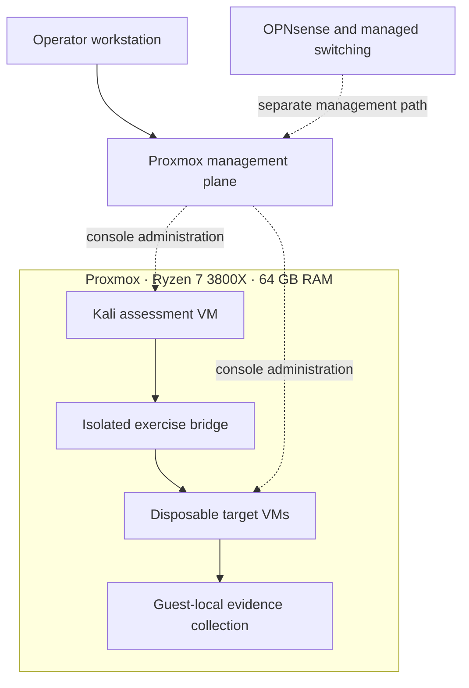

# JT Offensive Security Lab

**Proxmox · Kali Linux · Network assessment · Web application testing · Evidence and retesting**

A reproducible offensive-security project for my home lab: a Ryzen 7 3800X Proxmox host, Kali Linux, OPNsense and managed switching, with a reference design for isolated assessment targets. The project combines an experiment design with Python tooling for explicit scope validation, Nmap assessment planning, XML evidence analysis, and before/after exposure comparison.

**Author:** JT Corbin  
**Release:** 0.1.0 — reference implementation and synthetic demonstration, November 2026.

The included demo runs offline. This release does not claim that proposed target VMs are deployed, that penetration tests have been completed, or that vulnerabilities have been verified. Recorded hardware, proposed topology, executable tooling, and pending experiments are identified separately in the [evidence ledger](docs/evidence-ledger.md).

## Start with the working demonstration

Python 3.10+; no third-party Python dependencies, Kali installation, GPU, or network access required.

```bash
python -m offsec_lab demo
python -m unittest discover -s tests -v
python scripts/check_publication.py
```

The demo analyzes two fabricated Nmap XML files and prints an exposure comparison. It does not scan anything. Synthetic addresses use documentation-only ranges and are never submitted to tools.

## Lab architecture

| Component | Recorded hardware or role | How it relates to this repository |
|---|---|---|
| Operator workstation | Intel i9-13900KF, RTX 4080 16 GB, 64 GB DDR4 | Proxmox console and assessment review; outside target scope |
| Proxmox host | Ryzen 7 3800X, 64 GB DDR4, approximately 1 TB NVMe | Virtualized assessment environment; management plane excluded from target scope |
| Kali Linux | User-identified offensive testing environment | Assessment workstation; exact current guest placement/version to verify |
| OPNsense | Dedicated firewall appliance | Routed-zone policy and logging; not an assessment target in this project |
| Managed switch | Zyxel GS1900-16 | Segmentation infrastructure; real VLAN IDs and port mappings omitted |
| Storage/services | OMV NAS and separate service nodes | Supporting infrastructure; excluded from exercises |
| Separate compute server | Supermicro X9DRX+-F, dual E5-2680 v2, 128 GB ECC DDR3; 5 × P100 16 GB, RTX 3090 24 GB, RTX 3060 12 GB | Existing local AI server, included only for architectural completeness; excluded from offensive scope and not used by the tooling |

An RTX 3060 was also associated with earlier Proxmox hardware notes. This repository makes no claim about current passthrough, whether those records describe a different card, or simultaneous GPU allocation. Offensive exercises do not require a GPU.



This is the **proposed exercise topology**, not an export of the live network. Kali and the targets share an exercise-only bridge without a physical uplink or host IP. Do not infer real routing, addresses, VLAN IDs, guest IDs, or firewall state. See [architecture](docs/architecture.md) for isolation limits, including same-host layer-two traffic.

## Implemented in this repository

| Capability | Implementation | Limitation |
|---|---|---|
| Scope control | Exact IPv4 targets, small TCP port list, exclusions, short-lived local attestation | A declaration is not independent proof of authorization |
| Assessment planning | Fixed, bounded Nmap TCP-connect/service-discovery command | Planner prints a command; it never launches Nmap |
| Evidence ingestion | Bounded XML parsing with out-of-scope rejection and complete-run checks | Imported evidence is not independently authenticated |
| Exposure reporting | Alias-only port/state observations and fixed review prompts | Open ports and banners do not establish exploitable vulnerabilities |
| Retest comparison | Same declared coverage; additions and no-longer-open observations | Changed exposure is not proof of remediation |
| Publication review | No copied host configuration; restricted report fields; hygiene checker | Pattern matching cannot guarantee absence of sensitive information |

## Assessment tracks

1. **Network service discovery:** scoped Kali/Nmap assessment, explicit coverage, evidence parsing and service review.
2. **Web application assessment:** OWASP WSTG-guided testing of a disposable training application using two test accounts and reproducible requests.
3. **Linux configuration review:** verify a deliberately configured training weakness, document its preconditions, change one control and retest.
4. **Segmentation verification:** test declared allow/deny paths from fixed guest vantage points; separate routed controls from same-bridge exposure.
5. **Detection handoff:** align assessment timestamps and connection metadata with available firewall/guest evidence, without equating missing alerts with missing activity.

Track 1 has an offline reference implementation. Tracks 2–5 are detailed experiment runbooks; they are not automated exploits or completed engagement reports.

## Run against your private lab evidence

After maintenance, inventory the guests and verify isolation before selecting disposable targets. Copy `config/scope.local.example.json` to `config/scope.local.json` and complete it privately. Follow [Kali workflow](docs/kali-workflow.md).

```bash
# Print an operator-reviewed command for exact declared targets; no scan executes.
python -m offsec_lab plan --scope config/scope.local.json

# Analyze locally collected evidence and write alias-only reports.
python -m offsec_lab analyze --scope config/scope.local.json --input private/baseline.xml --output results/baseline

# Compare scans with the same declared target and port coverage.
python -m offsec_lab retest --scope config/scope.local.json --before private/baseline.xml --after private/retest.xml --output results/retest
```

Local command plans contain target addresses and stay private. Reports exclude addresses, hostnames, MACs, banners, scripts, credentials, and source filenames. They still reveal service exposure by alias, so review them before publication.

## Documentation

- [Architecture and trust boundaries](docs/architecture.md)
- [Proxmox build and recovery runbook](docs/proxmox-runbook.md)
- [Kali assessment workflow](docs/kali-workflow.md)
- [Rules of engagement](docs/rules-of-engagement.md)
- [Research and evaluation protocol](docs/research-methodology.md)
- [Experiments](experiments/README.md)
- [Evidence handling](docs/evidence-handling.md)
- [Findings template](templates/finding.md)
- [Engagement report template](templates/assessment-report.md)
- [Security and publication policy](SECURITY.md)

## Companion project

My [AI-powered security operations lab](https://github.com/johhny1010/jt-ai-security-ops-lab) documents a separate defensive monitoring and administration project. This repository focuses on offensive assessment methodology and evidence. No AI model, agent, model API, or GPU inference is used here. Its handoff contract is documented in [detection handoff](docs/detection-handoff.md); no live integration is claimed.

MIT license for the original reference code and documentation. External tools, training targets and operating-system images retain their own terms.
